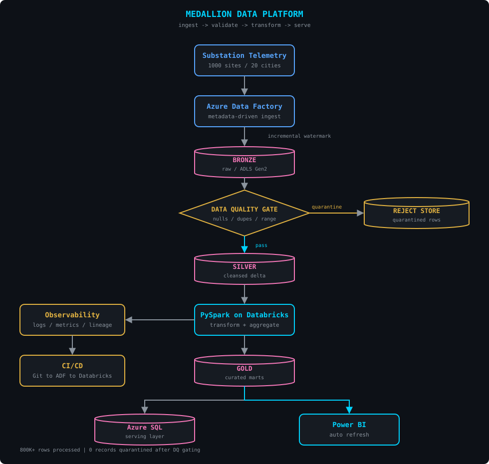
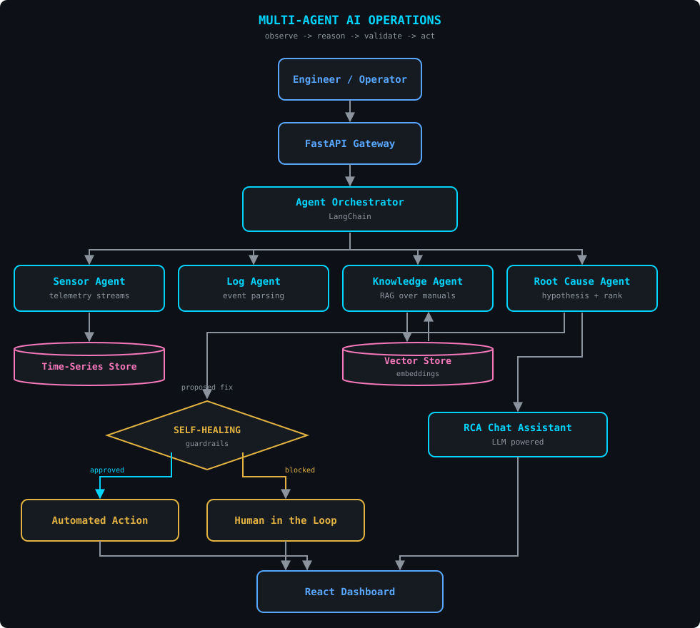

<!-- ============ HEADER ============ -->
<div align="center">


`Building reliable data pipelines` • `Shipping LLM agents` • `Modeling lakehouses` • `Automating everything`

</div>

---

## 🐧 `~/` whoami

```text
aman@data-lakehouse:~$ neofetch

        .--.      aman@data-lakehouse
       |o_o |     ────────────────────────────────────────────
       |:_/ |     User ······· Aman Gupta
      //   \ \    Role ······· Associate Software Engineer @ Nagarro
     (|     | )   OS ········· Linux (Ubuntu · WSL2)
    /'\_   _/`\   Host ······· PSIT Kanpur · B.Tech CSE (AI) · CGPA 8.8
    \___)=(___/   Kernel ····· PySpark · Databricks · Azure Data Factory
                  Shell ······ bash · zsh · pwsh
                  WM ········· Medallion (Bronze → Silver → Gold)
                  Packages ··· 600+ DSA solved (LeetCode · 1710)
                  CPU ········ Data Modeling · ETL/ELT · System Design
                  Memory ····· ADLS Gen2 · Azure SQL · MongoDB · Delta
                  GPU ········ LLMs · LangChain · RAG · AI Agents
                  Uptime ····· Always Learning, Always Shipping
                  Region ····· India
                  Locale ····· en_IN.UTF-8

                  ███ ███ ███ ███ ███ ███ ███ ███

aman@data-lakehouse:~$ cat stack.env

  LANGUAGES=python,java,javascript,sql
  ORCHESTRATION=azure-data-factory,databricks-workflows
  COMPUTE=pyspark,databricks,delta-lake
  STORAGE=adls-gen2,azure-sql,mongodb,mysql
  GENAI=langchain,rag,ai-agents,prompt-engineering
  SERVING=fastapi,node,express,spring-boot
  BI=power-bi
  INFRA=azure,aws,docker,git,github-actions
  STATUS=open_to_collaboration

aman@data-lakehouse:~$ uname -srm
Linux 6.x.x-lakehouse x86_64

aman@data-lakehouse:~$ █
```

<div align="center">


</div>

### Service Manifest

```yaml
identity:
  name: Aman Gupta
  role: Data Engineer · GenAI Developer
  company: Nagarro
  location: Gurugram, India

education:
  degree: B.Tech in Computer Science & Engineering (AI)
  institute: PSIT Kanpur
  cgpa: 8.8

engineering:
  builds:   Medallion lakehouses on Azure (ADF · ADLS · Azure SQL)
  compute:  PySpark + Databricks, metadata-driven incremental loads
  genai:    multi-agent LLM systems with LangChain, RAG, FastAPI
  serves:   REST APIs with FastAPI, Node.js, Spring Boot
  explores: agent orchestration, LLM evaluation, Delta Live Tables

proof_of_work:
  dsa_solved:  600+ problems on LeetCode (rating 1710)
  selected_for: Amazon ML Summer School 2025
  scale:       800K+ rows · 1,000 substations · 20 cities

contact:
  email: 40guptaaman@gmail.com
  ask_me_about: [ PySpark, ETL/ELT, RAG, AI Agents, Azure, DSA ]
```

---

## 🧑‍💻 About Me

- 🎓 **B.Tech CSE (AI)** | CGPA **8.8** | PSIT Kanpur
- 🏢 **Associate Software Engineer @ Nagarro** — data engineering + applied GenAI
- 🛠 Building **Medallion-architecture lakehouses** on **Azure Data Factory, ADLS Gen2, Azure SQL**
- ⚡ Writing **PySpark** on **Databricks** — incremental loads, watermarking, data-quality gates
- 🤖 Designing **multi-agent LLM systems** for real-time monitoring and root cause analysis
- 🧠 Solved **600+ DSA problems** on **LeetCode** → [Profile](https://leetcode.com/u/gupta_aman107/)
- 🏅 Selected for **Amazon ML Summer School 2025**
- 🤝 Open to **open-source collaboration & impactful data/AI projects**
- 📫 **Reach me:** `40guptaaman@gmail.com`

### ⏱️ Scheduled jobs

```text
aman@data-lakehouse:~$ crontab -l

# min  hour  dom  mon  dow    command
   0     2    *    *    *     /usr/bin/adf trigger --pipeline bronze_ingest --incremental
  30     3    *    *    *     /usr/bin/databricks run --job silver_transform --dq-checks
   0     5    *    *    *     /usr/bin/powerbi refresh --dataset grid_demand
   0     9    *    *   1-5    /usr/bin/build --agents --guarded --observable
  30    21    *    *    *     /usr/bin/leetcode solve --keep-streak
   0    22    *    *   6,0    /usr/bin/explore --llm --rag --eval
  @reboot                     /usr/bin/systemctl start always-learning
```

---

## 🏗️ How I Architect a Data Platform

> [!NOTE]
> The Medallion flow behind my Smart Grid pipeline — incremental ingestion, quality gates, curated marts, and automated BI refresh.

<div align="center">



</div>

---

## 🤖 How I Architect an Agent System

> [!NOTE]
> The multi-agent topology behind my HVAC AI Operations Platform — specialized agents, a guarded self-healing loop, and an LLM-powered RCA assistant.

<div align="center">



</div>

---

## ⚙️ PIPELINE RUN

<div align="center">


</div>

```text
aman@databricks-runner:~$ databricks jobs run-now --job-id smart_grid_medallion

✓ Bronze Ingest        1,000 substations · 800K+ rows · 00:04:12
✓ Data Quality Gate    nulls ✓  duplicates ✓  range ✓  → 0 quarantined
✓ Silver Transform     watermark advanced · merge complete · 00:06:48
✓ Gold Aggregation     20 city marts built · 00:02:31
✓ Power BI Refresh     dataset: grid_demand → 200 OK
```

---

# 🧠 Skill Set

| **⚡**<br>**Data Engineering** | <br>`PySpark` `Databricks` `Azure Data Factory` `ADLS Gen2` `Delta Lake` `ETL/ELT` `Medallion` `Power BI` |
| :-- | :-- |
| **🤖**<br>**Generative AI** | <br>`LLMs` `LangChain` `RAG` `AI Agents` `Prompt Engineering` `Transformers` `NLP` |
| **🗄️**<br>**Databases** | <br>`Azure SQL` `MongoDB` `MySQL` `Oracle` `SQL Tuning` |
| **⚙️**<br>**Backend & APIs** | <br>`FastAPI` `Node.js` `Express` `Spring Boot` `REST APIs` `JWT Auth` |
| **💻**<br>**Languages** | <br>`Python` `Java` `JavaScript` `SQL` |
| **🎨**<br>**Frontend** | <br>`React.js` `Next.js` `HTML5` `CSS3` |
| **🐳**<br>**Cloud & DevOps** | <br>`Microsoft Azure` `AWS` `Docker` `Git` `GitHub Actions` `GitLab` |

---

## 🚀 Featured Projects


```text
└─$ docker ps --format "table {{.NAMES}}\t{{.STATUS}}"
```

| # | Service | Description | Tech Stack | Status |
|:--|:--|:--|:--|:--|
| `01` | ⚡ **Smart Grid Pipeline** | Medallion lakehouse for substation telemetry & demand forecasting. **800K+ rows**, 1,000 substations, 20 cities, with automated Power BI refresh. | `ADF` `ADLS` `PySpark` `Azure SQL` `Power BI` |  |
| `02` | 🤖 **HVAC AI Ops Platform** | Multi-agent system (sensor · log · knowledge · RCA) for real-time monitoring, guarded self-healing and an LLM-powered RCA chat assistant. | `LangChain` `RAG` `FastAPI` `React` |  |
| `03` | 🏥 **SWASTH-CARE** | Role-based hospital management — **5+ modules** across OPD/IPD, bed allocation, lab reports, billing. RBAC cut unauthorized access **100%**, workflow **+30%**. | `React` `Node.js` `Express` `MongoDB` `JWT` |  |
| `04` | 🎨 **BoardMeet** | Real-time collaborative whiteboard with secure 1:1 WebRTC video. **95% sync accuracy**, **40% latency reduction**. | `React` `Node.js` `WebRTC` `Socket.io` |  |

> [!TIP]
> **Engineering wins worth noting:** `800K+` rows through a metadata-driven incremental framework · `0` quarantined records after DQ gating · `95%` real-time sync accuracy · `100%` RBAC coverage at the API layer.

🔗 Explore more in my [pinned repositories](https://github.com/fusionAman?tab=repositories)!

---

## 🏆 Achievements

<div align="center">


</div>

- 🏅 Selected for **Amazon ML Summer School 2025** from a competitive global applicant pool
- ⭐ **600+ problems** solved on [LeetCode](https://leetcode.com/u/gupta_aman107/) — rating **1710**
- 🔵 **Rating 1236** on [Codeforces](https://codeforces.com/profile/40guptaaman)
- ⭐ **5-Star in DSA** on [HackerRank](https://www.hackerrank.com/profile/CSAI_1520020)
- 🟢 **Rank 131** on [GeeksforGeeks](https://www.geeksforgeeks.org/user/aman_1520020/)
- 📜 **AWS Cloud Practitioner Essentials** · **Generative AI** · **PySpark / Apache Spark Programming**

---

## 📊 Dynamic GitHub & Coding Stats

```text
└─$ systemctl status aman.metrics --live
```

<div align="center">


### 📈 Contribution Heatmap


</div>

---

## 🤝 Connect with Me

```text
aman@data-lakehouse:~$ sudo apt install aman

Reading package lists... Done
Building dependency tree... Done
Reading state information... Done

The following NEW packages will be installed:
  aman  data-engineer  genai-developer  backend-engineer

Suggested packages:
  open-source-collaboration  impactful-data-projects

0 upgraded, 4 newly installed, 0 to remove.
After this operation, 800K+ rows will have been processed.
Do you want to continue? [Y/n] y

Setting up aman (2026.lakehouse) ...
✔ Ready to collaborate.
```

```http
GET /api/v1/aman/contact HTTP/1.1
Host: github.com
Accept: application/json

HTTP/1.1 200 OK
Content-Type: application/json
X-Response-Time: 11ms
```

```json
{
  "email":    "40guptaaman@gmail.com",
  "linkedin": "aman-gupta-9b9394260",
  "leetcode": "gupta_aman107",
  "github":   "fusionAman",
  "open_to":  ["open-source collaboration", "data & AI engineering projects"]
}
```

<div align="center">

<a href="https://linkedin.com/in/aman-gupta-9b9394260"></a>
<a href="mailto:40guptaaman@gmail.com"></a>
<a href="https://leetcode.com/u/gupta_aman107/"></a>
<a href="https://codeforces.com/profile/40guptaaman"></a>
<a href="https://www.hackerrank.com/profile/CSAI_1520020"></a>
<a href="https://github.com/fusionAman"></a>

---


</div>
